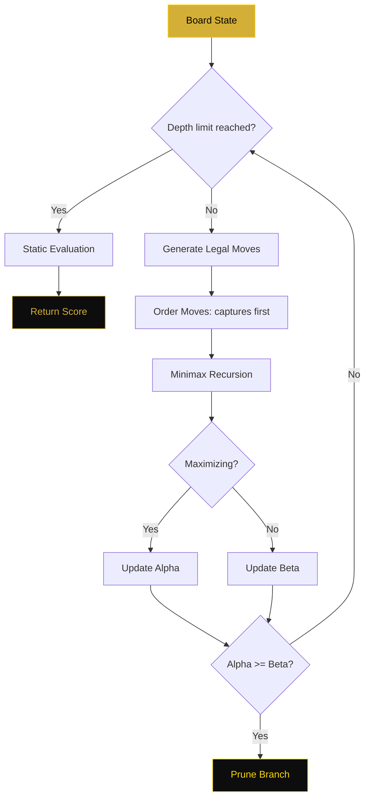

<div align="center">


<a href="https://git.io/typing-svg">
  
</a>

<br/>

<a href="https://www.linkedin.com/in/sampathi-yaswanth-a620ba37a/"></a>
<a href="mailto:yaswanthsampathi@gmail.com"></a>
<a href="https://www.instagram.com/_yashu.__07"></a>
<a href="https://yashuuuuuu.ai.studio"></a>


</div>

<br/>

## > boot sequence

```text
$ ./yaswanth --uci

id name        Sampathi Yaswanth
id author      Kalasalingam Academy of Research and Education
option Role    type combo default "CSE student, AI/ML engineer-in-training"
option Search  type combo default "minimax + alpha-beta"
option Stack   type combo default "Python | Java | JavaScript | SQL"
option Peak    type string default "23:00 - 02:00"
option Fuel    type string default "coffee"
uciok

$ isready
readyok

$ go infinite
info string  building AI-integrated web apps
info string  sharpening ML fundamentals and competitive programming
info string  open to research, algorithmic collabs, AI engineering roles
```

<br/>

## > position on the board

```text
    a b c d e f g h
 8  r n b q k b n r     Opening book : Python, Java, DSA
 7  p p p p p p p p     Middlegame   : Search, ML, GenAI, Web
 6  . . . . . . . .     Endgame      : Applied ML research
 5  . . . . . . . .
 4  . . . . P . . .     Last move    : 1. e4  (new project started)
 3  . . . . . . . .     Evaluation   : +3.4  (and improving)
 2  P P P P . P P P
 1  R N B Q K B N R     Side to move : Yaswanth
```

<br/>

## > play a round

<div align="center">

<a href="https://yashu440.github.io/night-lane/"></a>

<br/>

<a href="https://yashu440.github.io/night-lane/"></a>
<a href="https://github.com/yashu440/night-lane"></a>

<sub>Arrow keys or A / D to steer. Dodge traffic, grab the gold. Works on phone too.</sub>

</div>

<br/>

## > featured projects

<table width="100%">
<tr>
<td width="33%" valign="top" align="center">

### Chess Engine

Move-evaluation engine built on **minimax with alpha-beta pruning**. Capture-first move ordering cuts the search space before it explodes.

`Python` `Game AI` `Algorithms`


<a href="https://github.com/yashu440/chess-engine"></a>

</td>
<td width="33%" valign="top" align="center">

### GenAI Learning Platform

A **Flask** platform where generative AI shapes personalized, adaptive learning paths for students.

`Flask` `Python` `GenAI`


<a href="https://github.com/yashu440/genai-learning-platform"></a>

</td>
<td width="33%" valign="top" align="center">

### Task Manager

Desktop productivity app with full **CRUD**, persistent local storage and a clean Tkinter interface.

`Python` `SQLite` `Tkinter`


<a href="https://github.com/yashu440/task-manager"></a>

</td>
</tr>
</table>

<details>
<summary><b>How the engine thinks (expand the search tree)</b></summary>

<br/>



</details>

<br/>

## > evaluation function

How I score my own skills, the same way the engine scores a position. Higher is better, and it keeps being re-searched.

<div align="center">

| Component | Weight | Depth searched |
|:---|:---:|:---|
| Python | 0.85 | AI, backend, scripting, tooling |
| Algorithms and Search | 0.75 | Minimax, pruning, DSA, competitive programming |
| Flask / Django | 0.75 | Full-stack web, REST APIs |
| Java | 0.70 | OOP, data structures |
| SQL | 0.70 | Relational design, queries |
| Machine Learning | 0.65 | Fundamentals, PyTorch, NumPy, Pandas |

<br/>


<br/><br/>


</div>

<br/>

## > telemetry

<div align="center">


<br/>


<br/>


</div>

<br/>

## > game record (PGN)

```text
[Event   "Career"]
[Site    "Kalasalingam Academy, India"]
[White   "Sampathi Yaswanth"]
[Black   "The Unknown"]
[Result  "*"]

1. Python Java        { foundations, DSA, first line of competitive programming }
2. Minimax AlphaBeta  { chess engine, search pruning that finally clicked }
3. Tkinter SQLite     { task manager, a full CRUD app end to end }
4. Flask GenAI        { learning platform, AI wired into a real web app }
5. Placements ...     { 2026, the position is being calculated }
6. ML Research ...    { deeper applied machine learning }
7. AI Engineer #      { checkmate, still ahead on the clock }
```

<br/>

## > make your move

<div align="center">

> *"The best way to learn is to build, break, and rebuild, better."*

<a href="https://www.linkedin.com/in/sampathi-yaswanth-a620ba37a/"></a>
<a href="mailto:yaswanthsampathi@gmail.com"></a>
<a href="https://github.com/yashu440"></a>
<a href="https://yashuuuuuu.ai.studio"></a>

<br/><br/>

<a href="https://www.buymeacoffee.com/yashu440"></a>
<a href="https://github.com/sponsors/yashu440"></a>

<br/><br/>


</div>
