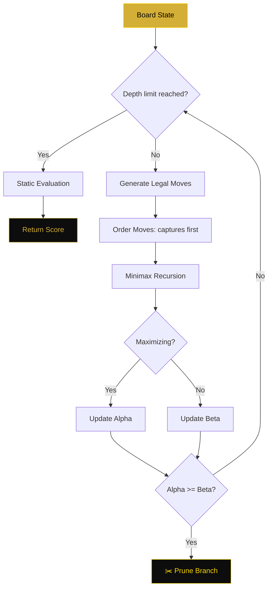
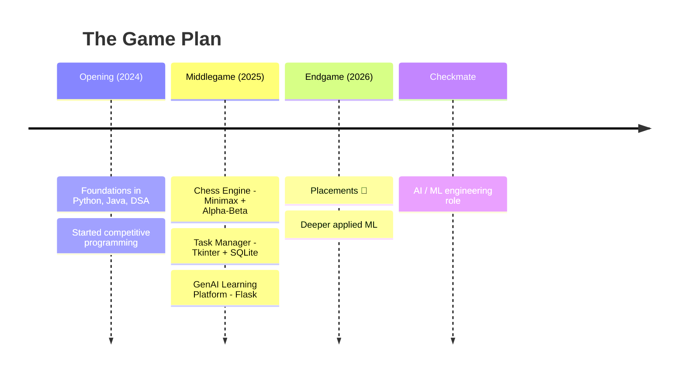

<div align="center">


<a href="https://git.io/typing-svg">
  
</a>

<br/>

<a href="https://www.linkedin.com/in/sampathi-yaswanth-a620ba37a/"></a>
<a href="mailto:yaswanthsampathi@gmail.com"></a>
<a href="https://www.instagram.com/_yashu.__07"></a>
<a href="https://yashuuuuuu.ai.studio"></a>


</div>

<br/>

## ♟️ Player Card

```python
class Yaswanth:
    role      = "CSE student · AI/ML engineer-in-training"
    college   = "Kalasalingam Academy of Research and Education"
    plays     = ["Minimax", "Alpha-Beta", "Generative AI", "Competitive Programming"]
    languages = ["Python", "Java", "JavaScript", "SQL"]
    peak_time = "11 PM – 2 AM"
    fuel      = "coffee"

    def current_move(self):
        return "Building AI-integrated web apps + sharpening CP fundamentals"

    def open_to(self):
        return ["AI/ML research", "algorithmic collabs", "AI engineering roles"]

    def philosophy(self):
        return "Clean code is a form of respect."
```

<div align="center">

| 🧠 Thinks in | ⚡ Optimizes for | 🎯 Aiming at |
|:---:|:---:|:---:|
| Game trees | Correct, readable code | Applied ML · Research · AI engineering |

</div>

<br/>

## 🏆 Featured Projects — *The Opening Book*

<table width="100%">
<tr>
<td width="33%" valign="top" align="center">

### ♛ Chess Engine
Move-evaluation engine using **minimax + alpha-beta pruning**, with capture-first move ordering to cut the search space.

`Python` `Game AI` `Algorithms`


[**View Repo →**](https://github.com/yashu440/chess-engine)

</td>
<td width="33%" valign="top" align="center">

### 🤖 GenAI Learning Platform
A **Flask** web platform that uses generative AI to deliver personalized, adaptive learning for students.

`Flask` `Python` `GenAI`


[**View Repo →**](https://github.com/yashu440/genai-learning-platform)

</td>
<td width="33%" valign="top" align="center">

### ✅ Task Manager
Desktop productivity app with full **CRUD**, persistent local storage and a clean Tkinter UI.

`Python` `SQLite` `Tkinter`


[**View Repo →**](https://github.com/yashu440/task-manager)

</td>
</tr>
</table>

<details>
<summary><b>♟️ How my Chess Engine thinks (click to expand)</b></summary>



</details>

<br/>

## 🧩 Skills — *My Pieces on the Board*

<div align="center">

| Piece | Skill | Role |
|:---:|:---|:---|
| ♛ **Queen** | Python | Most versatile — AI, backend, scripting |
| ♜ **Rook** | Algorithms & Search | Straight-line power: minimax, pruning, DSA |
| ♝ **Bishop** | Machine Learning · Generative AI | Cutting diagonally into the future |
| ♞ **Knight** | Flask · Django · Node.js | Jumps across the stack |
| ♟️ **Pawn** | Java · SQL · HTML/CSS/JS | The foundation everything advances from |

<br/>


<br/><br/>


</div>

<br/>

## 📊 GitHub Analytics

<div align="center">


<br/>


<br/>


</div>

<br/>

## 🗺️ Roadmap — *Opening → Middlegame → Endgame*



<br/>

## 🤝 Let's Connect

<div align="center">

> *"The best way to learn is to build, break, and rebuild — better."*

<a href="https://www.linkedin.com/in/sampathi-yaswanth-a620ba37a/"></a>
<a href="mailto:yaswanthsampathi@gmail.com"></a>
<a href="https://github.com/yashu440"></a>
<a href="https://yashuuuuuu.ai.studio"></a>

<br/><br/>

<a href="https://www.buymeacoffee.com/yashu440"></a>
<a href="https://github.com/sponsors/yashu440"></a>

<br/><br/>


</div>
